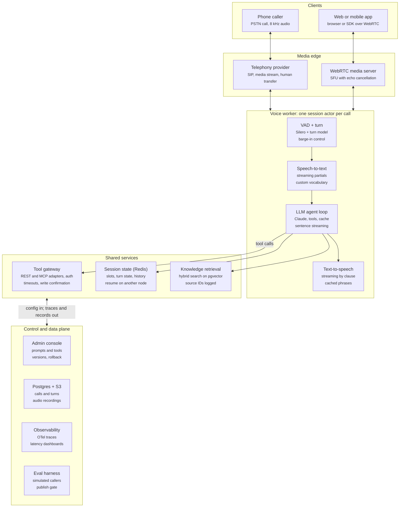
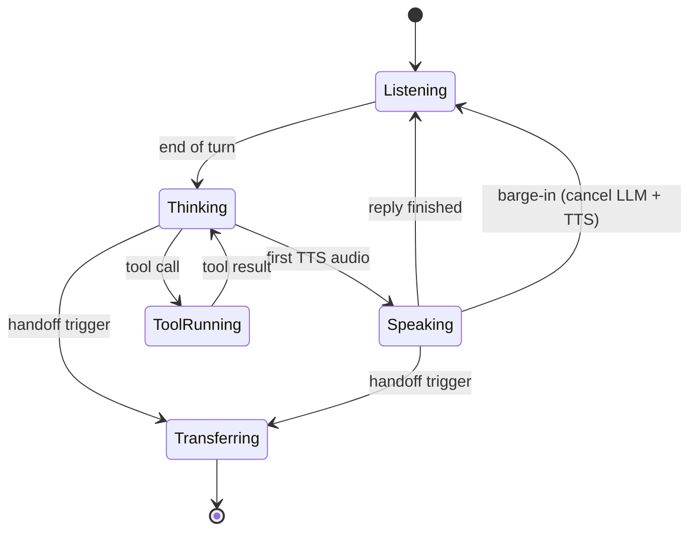
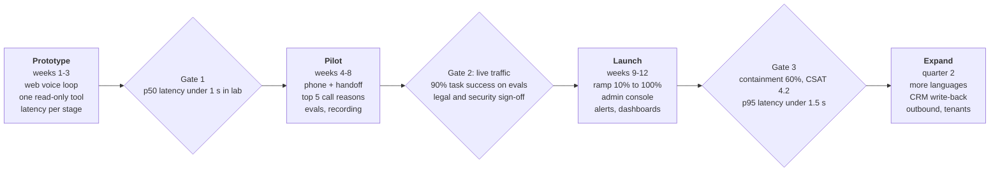

# Voice AI Agent — PRD, System Design & Architecture

As of 2026-11-19

## 1. Overview

We will build a real-time voice agent that answers calls and web voice sessions, holds a natural spoken conversation, takes actions through tools (look up an order, book a slot, update a record), and hands off to a human when it should. Target: a caller hears the first word of a reply within 800 ms of finishing their sentence (p50).

**Problem.** Phone and voice support is expensive, has long queues outside business hours, and IVR menus frustrate callers. Text chatbots don't help people who call.

**Vision.** One agent platform: configure a persona, a knowledge base and a set of tools, then deploy it to a phone number, a web widget or a mobile app.

**Assumptions to confirm.** These shape everything below; change them and the design shifts.

- First use case is customer support plus scheduling for one business (single tenant), with multi-tenant later.
- Channels: inbound phone (PSTN via a telephony provider) and browser (WebRTC). Outbound calling is phase 3.
- English first; two more languages in phase 2.
- Cascaded pipeline (speech-to-text, then LLM, then text-to-speech) rather than a single speech-to-speech model, for control, tool use and auditability.

## 2. Goals, non-goals and success metrics

Success means callers finish their task without a human, fast enough that it feels like a conversation, at a cost well below a human-handled call.

**Goals**

- Natural turn-taking: low latency, barge-in (caller can interrupt), no talking over the caller.
- Resolve the top 5 call reasons end to end through tools.
- Safe escalation to a human with full context passed along.
- Every call recorded, transcribed, traced and scorable.

**Non-goals (v1)**

- Training our own speech or language models.
- Outbound sales or campaign dialling.
- Payments by voice (PCI scope) — hand off instead.
- Emotion detection or voice biometrics.

**Metrics**

| Metric | Target (v1) | How measured |
| --- | --- | --- |
| Voice-to-voice latency | p50 ≤ 800 ms, p95 ≤ 1.5 s | End of caller speech → first agent audio byte, per turn |
| Containment rate | ≥ 60% of in-scope calls | Calls closed without human transfer |
| Task success | ≥ 90% on eval set | Scripted simulated calls graded by rubric |
| Wrong-action rate | < 0.5% of tool calls | Audit of write actions |
| CSAT | ≥ 4.2 / 5 | Post-call survey |
| Interruption handling | ≥ 95% stop within 300 ms | Agent audio stops after caller barge-in |
| Cost per minute | Set after vendor quotes | Telephony + STT + LLM + TTS + infra |
| Uptime | 99.9% monthly | Call setup success |

## 3. Users and use cases

Three people touch the system: the caller who talks to it, the human agent who takes escalations, and the operator who configures and monitors it.

| Persona | Needs | Key moment |
| --- | --- | --- |
| Caller | Quick answer or action, no menus, can interrupt, can reach a human | First 5 seconds: is this worth talking to? |
| Human agent | Summary, transcript and collected data on transfer; no repeat questions | Warm transfer |
| Operator / admin | Edit prompt, tools, knowledge; review calls; see metrics; roll back | Shipping a prompt change safely |
| Developer | Add a tool via an API spec; test locally; replay calls | Debugging a bad call |

**User stories (v1)**

1. As a caller, I ask "where is my order?", give my order number, and hear the status and delivery date.
2. As a caller, I book, move or cancel an appointment and receive an SMS confirmation.
3. As a caller, I ask a policy question and get an answer grounded in the knowledge base.
4. As a caller, I interrupt mid-sentence and the agent stops and listens.
5. As a caller, I say "talk to a person" and I'm transferred with my context.
6. As an operator, I change the greeting, run the eval suite, and publish only if scores hold.
7. As an operator, I search calls by outcome, listen to the recording, and read the trace of each tool call.

## 4. Functional requirements

P0 is the minimum for a pilot on real calls; P1 follows within the first quarter after launch.

| ID | Requirement | Priority |
| --- | --- | --- |
| F1 | Accept inbound PSTN calls and browser WebRTC sessions | P0 |
| F2 | Stream caller audio to speech-to-text with partial and final transcripts | P0 |
| F3 | Detect end of turn (voice activity + semantic endpointing) | P0 |
| F4 | Barge-in: stop agent audio and cancel in-flight generation when the caller speaks | P0 |
| F5 | LLM agent with system prompt, conversation memory and tool calling | P0 |
| F6 | Stream text-to-speech sentence by sentence while the LLM is still generating | P0 |
| F7 | Tool framework: HTTP/MCP tools with schemas, timeouts, retries, auth | P0 |
| F8 | Read-back confirmation before any write action (book, cancel, update) | P0 |
| F9 | Knowledge-base answers via retrieval (RAG) with source logging | P0 |
| F10 | Warm transfer to a human (SIP transfer or queue) with summary | P0 |
| F11 | Call recording, transcript and per-turn trace stored | P0 |
| F12 | Filler / acknowledgement audio when a tool takes > 1 s ("Let me check that") | P0 |
| F13 | DTMF input fallback (keypad) for numbers | P1 |
| F14 | Post-call summary, disposition and CRM write-back | P1 |
| F15 | Admin console: persona, prompts, tools, voices, versions, rollback | P1 |
| F16 | Evaluation harness: simulated callers, rubric grading, regression gate | P1 |
| F17 | Multilingual detection and response | P1 |
| F18 | Outbound calls and scheduled callbacks | P2 |

## 5. Non-functional requirements and latency budget

Latency is the requirement that drives the architecture: every stage must stream, and nothing may wait for a previous stage to finish completely.

**Latency budget (p50, end of caller speech → first agent audio)**

| Stage | Budget (ms) | How we hit it |
| --- | --- | --- |
| End-of-turn detection | 250 | VAD silence threshold ~200 ms + semantic turn model; shorter when the utterance is clearly complete |
| STT final transcript | 100 | Streaming STT; partials already processed, only the tail remains |
| LLM time to first sentence | 300 | Low effort, cached system prompt and tools, short first sentence, regional endpoint |
| TTS time to first audio | 100 | Streaming TTS fed per sentence or clause; warm connection |
| Network + media transport | 50 | Media server in the same region as the models; Opus/WebRTC or 20 ms PCM frames |
| **Total** | **800** | |

Tool calls add their own time; F12 filler audio covers any call over 1 s so silence never exceeds about 1.5 s.

**Other non-functional requirements**

| Area | Requirement |
| --- | --- |
| Scale | 200 concurrent calls at launch, horizontally scalable to 5,000 |
| Availability | 99.9% call setup; a failed provider degrades to a backup within one turn |
| Audio quality | 8 kHz telephony and 16–48 kHz web; echo cancellation and noise suppression on web |
| Security | TLS/SRTP in transit, AES-256 at rest, secrets in a vault, least-privilege tool credentials |
| Privacy | PII redaction in logs and transcripts, configurable retention (default 30 days audio, 1 year transcripts), call-recording consent notice |
| Compliance | GDPR/CCPA data rights; HIPAA or PCI only with matching vendor agreements |
| Observability | Per-turn trace with stage timings, tokens, tool calls, cost |
| Portability | STT, LLM and TTS behind interfaces so vendors can be swapped |

## 6. High-level architecture

The system has four layers: a media edge that terminates calls, voice workers that run the real-time pipeline, shared services the agent calls, and a control plane for configuration and analysis.



Caller audio flows down through the media edge into the worker's pipeline and the synthesized reply flows back up the same path; only the LLM loop reaches out to tools, state and knowledge. Human transfer is a SIP transfer at the telephony provider, triggered by the worker.

## 7. Detailed system design

Each call is one stateful **session actor** that owns the audio streams, the conversation state and a cancellable pipeline; everything inside it streams.

### 7.1 One conversational turn

1. Audio frames (20 ms) arrive from the telephony or WebRTC gateway at the session actor.
2. Noise suppression and VAD run on every frame; frames stream to STT continuously.
3. STT returns partial transcripts; the turn detector combines silence length with a small model that judges whether the sentence is complete.
4. On end of turn, the final transcript is appended to the history and an LLM request starts streaming.
5. LLM text tokens are cut into sentences or clauses and each chunk is sent to streaming TTS immediately.
6. TTS audio streams back out to the caller; the session marks which words were actually played.
7. If the LLM emits a tool call, the orchestrator plays a short filler line, executes the tool, appends the result and continues the stream.

### 7.2 Turn-taking and barge-in

The session runs a small state machine: **Listening → Thinking → Speaking → Listening**, plus **Tool-running** and **Transferring**.



- Caller speech detected while Speaking (VAD above threshold for ~150 ms and STT confirms words) → stop playback, cancel the LLM stream and pending TTS, go to Listening.
- Tell the model what the caller actually heard: keep the assistant message in history unchanged (the API rejects edited history with thinking blocks) and add a mid-conversation system note on the next turn, e.g. "The caller interrupted; they heard only: ...". If the caller interrupts before the model answered at all, drop that unanswered turn and prepend its words to the next utterance.
- Ignore backchannels ("mm-hm", "yeah") with a short word list plus the turn model, so they don't interrupt.
- Echo: rely on acoustic echo cancellation on web; on phone lines, gate VAD during the agent's own audio peaks.

### 7.3 Speech-to-text

- Streaming STT over WebSocket with partials, word timestamps, custom vocabulary (product names, street names) and per-language models.
- Normalize numbers, emails and order IDs; ask for spelling or DTMF when confidence is low.

### 7.4 LLM agent loop

- Model: Claude via the Messages API with streaming and tool use. Start with `claude-opus-5-5` at `effort: "low"` and `speed: "fast"` for the conversational turn; benchmark `claude-sonnet-5-5` and `claude-haiku-5-5` on the eval set for latency and cost, and keep whichever holds task success.
- Prompt layout for caching: frozen system prompt (persona, policies, spoken-style rules) → tool definitions in a fixed order → conversation. Volatile facts (caller ID, time, account summary) go in a mid-conversation system message, not the top-level system prompt, so the cached prefix survives.
- Spoken-style rules in the prompt: short sentences, no markdown or lists, spell out numbers and dates, one question at a time, confirm before writes.
- Tools use `strict: true` schemas; inputs are validated before execution; write tools require a confirmed flag set only after the caller says yes.
- Handle `stop_reason`: `tool_use` → run tools; `refusal` → use the server-side fallback, else apologise and transfer; `max_tokens` → trim.
- Hard limits per session: max turns, max tool calls per turn, max cost; exceed → transfer.

### 7.5 Text-to-speech

- Streaming TTS with a persistent connection per session, chunked by sentence; first chunk kept short so audio starts fast.
- Text normalization before TTS ("$12.50" → "twelve dollars fifty"); SSML or phoneme hints for brand names.
- Cache common phrases (greeting, fillers, hold lines) as pre-rendered audio.

### 7.6 Tools and knowledge

- Tool gateway: each tool is a declared schema plus an adapter (REST, gRPC or MCP server) with timeout (default 3 s), retries for idempotent reads, and a per-tenant credential scope.
- Knowledge retrieval: hybrid search (keyword + vector) over chunked documents; top results go into the tool result with source IDs, which are logged for audit.

### 7.7 Memory and state

- Working memory: the message history in the session actor, compacted when it grows (summary of older turns).
- Session state: slots collected (name, order ID, verified flag) stored in Redis keyed by call ID, so another node can resume after a failure.
- Long-term memory (P1): per-caller profile and last-call summary, loaded at call start after identity is verified.

### 7.8 Human handoff

- Triggers: caller asks, repeated misunderstanding (2 failed turns), policy topics, refusals, low confidence on a write.
- Generate a 3-line summary and slot dump, then SIP REFER / queue transfer; the human agent's desktop shows summary and transcript.

## 8. Data model, storage and APIs

Postgres holds configuration and call records, Redis holds live session state, object storage holds audio, and a vector index holds knowledge chunks.

**Core entities**

| Entity | Key fields | Store |
| --- | --- | --- |
| Agent | id, tenant_id, name, active_version_id | Postgres |
| AgentVersion | id, agent_id, system_prompt, voice_id, stt_config, llm_config, tool_ids[], eval_score, published_at | Postgres (immutable) |
| Tool | id, name, json_schema, adapter_type, endpoint, auth_ref, timeout_ms, is_write | Postgres |
| Call | id, agent_version_id, channel, from, to, started_at, ended_at, outcome, transferred, cost_usd | Postgres |
| Turn | id, call_id, idx, role, text, started_at, stage_timings_ms{}, interrupted, tokens_in, tokens_out | Postgres (partitioned by month) |
| ToolCall | id, turn_id, tool_id, input, output, status, latency_ms | Postgres |
| Recording | call_id, uri, duration_s, redacted | Object storage (S3/GCS) |
| KnowledgeChunk | id, doc_id, text, embedding, source_url, updated_at | Vector DB / pgvector |
| SessionState | call_id, slots{}, verified, fsm_state, history_ref | Redis (TTL 2 h) |

**External APIs**

| Endpoint | Purpose |
| --- | --- |
| `POST /v1/telephony/webhook` | Provider callback on inbound call; returns media-stream URL |
| `WS /v1/media/{call_id}` | Bidirectional audio stream (telephony) |
| `POST /v1/web/sessions` | Create web session; returns WebRTC room token |
| `GET/POST /v1/agents`, `/v1/agents/{id}/versions` | Configure and publish agent versions |
| `POST /v1/agents/{id}/versions/{v}/evaluate` | Run eval suite against a version |
| `GET /v1/calls`, `/v1/calls/{id}` | Search calls; fetch transcript, trace, recording link |
| `POST /v1/webhooks` | Subscribe to call.ended, call.transferred events |

## 9. Scaling, reliability, security and privacy

Calls are long-lived and stateful, so we scale by placing whole sessions on worker nodes, not by load-balancing individual requests.

**Scaling**

- Voice workers are stateless containers that each host N session actors (start with ~50 calls per 4 vCPU node; measure). A dispatcher assigns new calls to the least-loaded worker.
- Autoscale on active sessions, not CPU; keep 20% warm headroom because call spikes are sudden.
- Drain on deploy: a node stops taking new calls and exits when its last call ends.
- Provider rate limits (LLM tokens/minute, STT/TTS concurrent streams) are tracked centrally; request quota increases before launch.

**Reliability**

- Each provider sits behind an interface with a secondary vendor; circuit breaker switches on timeouts or error spikes.
- If a worker dies, the gateway reconnects the media stream to a new worker, which reloads SessionState from Redis and says "Sorry, I missed that — could you repeat?".
- Total outage fallback: route calls to the human queue or voicemail.
- Per-turn watchdog: no audio for 4 s → play a holding line; 10 s → transfer.

**Security**

- Telephony webhooks verified by signature; web sessions use short-lived tokens.
- Tools run with per-tenant, least-privilege credentials from a secret manager; the LLM never sees secrets.
- Prompt-injection defence: tool results and knowledge text are treated as data; write actions require explicit caller confirmation and server-side policy checks (amount limits, verified identity).
- Identity verification (e.g. last 4 digits + postcode, or OTP via SMS) before account-specific data or writes.

**Privacy and compliance**

- Recording-consent message at call start where required by jurisdiction.
- PII redaction pass on transcripts and logs; raw audio access restricted and audited.
- Retention policies per tenant; delete-on-request across Postgres, object storage, vector index and vendor logs.
- Choose vendors with zero or limited data retention and signed DPAs; HIPAA/PCI only with BAAs/attestations in place.

## 10. Evaluation, observability and guardrails

No prompt, model or tool change ships unless the eval suite passes; production calls feed new eval cases every week.

**Evaluation**

- **Text-level evals:** 200+ scripted conversations (happy paths, edge cases, adversarial callers, prompt-injection attempts) run against the agent with mocked tools; an LLM judge grades each against a rubric (task done, correct tool args, policy followed, tone, brevity).
- **Voice-level evals:** simulated callers via TTS with accents, background noise and interruptions, piped through the full pipeline to measure STT errors, turn-taking and latency.
- **Regression gate:** a new AgentVersion publishes only if task success and wrong-action rate are no worse than the active version.
- **Production sampling:** 2% of calls plus all transferred or low-CSAT calls are reviewed by humans; failures become eval cases.

**Observability**

- One trace per call, one span per turn, child spans for VAD, STT, LLM, tool, TTS, with timings, tokens and cost (OpenTelemetry).
- Dashboards: latency per stage (p50/p95), containment, transfer reasons, tool error rates, cost per call, provider health.
- Alerts: p95 latency > 1.5 s for 5 minutes, tool error rate > 5%, call setup failures, cost per call above budget.
- Call replay: play recording alongside transcript, turn timings and tool calls.

**Guardrails**

- Topic and policy rules in the system prompt plus a server-side allow-list of tools per agent.
- Confirmation before writes; amount and frequency limits enforced in the tool gateway, not the prompt.
- Output filter for spoken text (no URLs read aloud, no internal IDs, no profanity).
- Escalate on repeated failure, caller distress keywords, or refusal.

## 11. Tech stack, build vs buy, and cost model

Buy the commodity layers (telephony, speech, model), build the orchestration, tools, evals and console — that is where the product differs. Vendor names below are candidates from general knowledge, not a checked market scan; run a 2-week bake-off on latency, accuracy and price before committing.

| Layer | Recommendation | Candidates to evaluate | Build or buy |
| --- | --- | --- | --- |
| Telephony | Programmable voice with media streams + SIP transfer | Twilio, Telnyx, Vonage | Buy |
| Web/mobile media | WebRTC SFU | LiveKit (open source or cloud), Daily | Buy / self-host |
| Pipeline framework | Open-source voice-agent framework to avoid rebuilding audio plumbing | LiveKit Agents, Pipecat | Adopt + extend |
| VAD / turn detection | Local VAD + semantic turn model | Silero VAD, framework turn detectors | Adopt |
| STT | Streaming, low-latency, custom vocabulary | Deepgram, AssemblyAI, Speechmatics | Buy |
| LLM | Claude Messages API, streaming + tools + prompt caching | `claude-opus-5-5` (low effort, fast mode); benchmark `claude-sonnet-5-5`, `claude-haiku-5-5` | Buy |
| TTS | Streaming, natural voice, low first-byte latency | ElevenLabs, Cartesia, Deepgram Aura | Buy |
| Orchestrator + tool gateway | Python (asyncio) or TypeScript service | — | Build |
| Data | Postgres + pgvector, Redis, S3-compatible storage | — | Managed services |
| Infra | Kubernetes in one region near providers, then multi-region | AWS / GCP | Managed |
| Observability | OpenTelemetry → Grafana / Datadog / Langfuse | — | Buy |
| Admin console | Next.js + the platform API | — | Build |

**Alternative:** a speech-to-speech realtime model gives lower latency and better prosody but less control over tools, transcripts and swapping vendors. Revisit after v1 if latency targets are missed.

**Cost model (per call minute)**

```
C_min = C_telephony + C_STT + C_TTS × r_agent + (T_in × p_in + T_out × p_out) / minutes + C_infra
```

r_agent is the share of the minute the agent speaks (typically 0.4–0.5). LLM input tokens dominate on long calls because history is resent each turn, so prompt caching matters most: cached reads on `claude-opus-5-5` cost $0.20 per million tokens against $4 for uncached input ($20 per million output; fast mode doubles both to $8 / $40). Fill vendor prices in after quotes.

## 12. Roadmap, risks and open questions

A small team (2–3 engineers plus a part-time designer) can reach a phone pilot in about 8 weeks and full launch in about 12; the durations are proposals to adjust once vendors are chosen.



Each gate is a go/no-go: miss it and the phase extends rather than the next one starting. Real callers arrive only after Gate 2.

**Risks**

| Risk | Impact | Mitigation |
| --- | --- | --- |
| Latency above 1.5 s on phone lines | Callers talk over the agent, hang up | Co-locate providers, stream every stage, filler audio, benchmark smaller models |
| Wrong write action (booking, cancellation) | Customer harm, trust loss | Read-back confirmation, server-side policy checks, audit log, undo window |
| STT errors on names, numbers, accents | Failed lookups, loops | Custom vocabulary, spelling and DTMF fallback, confirm critical fields |
| Prompt injection via knowledge or tool data | Policy bypass | Treat retrieved text as data, tool allow-lists, write actions gated outside the model |
| Vendor outage or rate limits | Dropped calls | Secondary vendors behind interfaces, circuit breakers, human-queue fallback |
| Cost per minute above plan | Unit economics fail | Prompt caching, history compaction, model and effort tuning per route |
| Recording and privacy rules differ by region | Legal exposure | Consent prompts, retention policies, legal review at gate 2 |

**Open questions**

- [ ] Which business and which 5 call reasons are in the pilot?
- [ ] Which systems hold orders and appointments, and do they have APIs?
- [ ] Expected call volume and peak concurrency?
- [ ] Regulated data in scope (health, payments)?
- [ ] Languages and regions at launch?
- [ ] Human team for escalations: hours and transfer method (SIP, queue, callback)?
- [ ] Budget ceiling per call minute?
